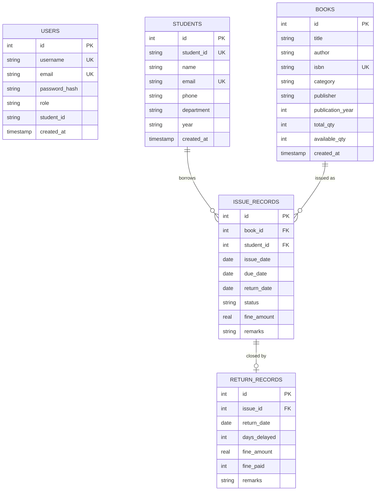

# 📚 Library Management System (LMS)

A modern, responsive, full-stack **Library Management System** engineered using **Python Flask**, **SQLite3**, **HTML5**, **CSS3**, **Bootstrap 5**, and **Chart.js**.

Designed for colleges, universities, and public libraries to seamlessly manage book catalogs, student registrations, book issuance, automated return workflows, and late fee fine calculations.

---

## 🌟 Key Features & Highlights

- 🔐 **Role-Based Access Control (RBAC):** Distinct dashboards and capabilities for **Administrators** and **Students**.
- 📊 **Interactive Analytics Dashboard:** Real-time metrics for Total Books, Available Inventory, Issued Books, Overdue Loans, and Pending Fines, powered by **Chart.js** (Category Doughnut & Circulation Bar charts).
- 📖 **Full Catalog CRUD Operations:** Add, view, edit, search, filter, and safely delete books. Protects books currently on loan from accidental deletion.
- 👨‍🎓 **Student Management:** Register and maintain student profiles across departments and academic years with full circulation loan histories.
- 🔄 **Circulation Engine:** 
  - 14-day automated loan period with dynamic due date computation.
  - Automatic inventory stock decrementing and incrementing.
  - Prevention of issuing out-of-stock titles or duplicate active copies to the same student.
- 💰 **Late Return Fine Engine:** Automatic overdue detection with fine calculation at **₹5.00 per day** past due date, with settlement tracking.
- 📑 **Comprehensive Reporting & CSV Export:** Stock summaries, top-borrowed books, overdue borrower audit lists, and one-click CSV export / print view.
- 📱 **Responsive & Modern UI:** Built with Bootstrap 5.3, Bootstrap Icons, Google Fonts (Plus Jakarta Sans), animated sidebar, glassmorphic accents, and instant client-side table filters.

---

## 🏗️ Technology Stack

| Component | Technologies |
|---|---|
| **Frontend** | HTML5, CSS3, JavaScript (ES6+), Bootstrap 5.3.3, Bootstrap Icons 1.11.3 |
| **Data Visualization** | Chart.js 4.4.2 |
| **Backend** | Python 3.12+ / 3.13, Flask 3.1, REST APIs |
| **Database** | SQLite3 (`library.db`) with Foreign Key constraints |
| **Security** | `Werkzeug` secure password hashing (`scrypt`/`pbkdf2`), Session authentication |

---

## 🗂️ Project Structure

```text
Library_Management_System/
│
├── app.py                  # Primary Flask backend application & routing
├── database.py             # SQLite database setup, schema & sample data seed
├── test_app.py             # Automated unit & integration test suite
├── requirements.txt        # Python dependency manifest
├── run.bat                 # One-click Windows runner script
├── library.db              # SQLite relational database
│
├── templates/              # Jinja2 HTML5 Templates
│   ├── base.html           # Unified master layout, sidebar & navigation
│   ├── login.html          # Authentication login portal
│   ├── register.html       # Student / Admin registration
│   ├── dashboard.html      # Central analytics dashboard & charts
│   ├── books.html          # Book catalog with search & filters
│   ├── add_book.html       # Add & Edit book form
│   ├── students.html       # Student directory
│   ├── add_student.html    # Add & Edit student form
│   ├── student_detail.html # Student profile & loan history
│   ├── issue_book.html     # Loan checkout & issue form
│   ├── return_book.html    # Return processing modal & fine settlement
│   ├── transactions.html   # Full audit history & filters
│   ├── reports.html        # Reports, analytics & CSV export
│   ├── 404.html            # Custom 404 error page
│   └── 500.html            # Custom 500 error page
│
├── static/
│   ├── css/
│   │   └── style.css       # Custom library-themed stylesheet
│   ├── js/
│   │   └── script.js       # Client-side reactivity, calculations & modals
│   └── images/
│       └── library-logo.svg
│
└── README.md               # Complete documentation
```

---

## 🔑 Default Login Credentials

The system automatically initializes and seeds standard accounts for instant testing:

### 1. Administrator Account
- **Username:** `admin` (or `admin@library.com`)
- **Password:** `admin123`
- **Role:** Administrator (Full Access to CRUD, Issuing, Returning, Reports, CSV Exports)

### 2. Sample Student Account
- **Username:** `rahul` (or `rahul.sharma@college.edu`)
- **Password:** `student123`
- **Role:** Student (Catalog browsing, personal loan tracking, overdue alerts)

*(Note: The login page includes convenient one-click fill buttons for both Admin and Student testing).*

---

## 🚀 Step-by-Step Execution Guide (VS Code)

### Prerequisites
- [Python 3.10+](https://www.python.org/downloads/) installed.
- [Visual Studio Code](https://code.visualstudio.com/) installed.

### Step 1: Open the Project in VS Code
1. Launch **Visual Studio Code**.
2. Go to **File** ➔ **Open Folder...**
3. Select this folder: `Library Management system`.
4. Open the built-in terminal: Press ``Ctrl + ` `` (Backtick) or go to **Terminal** ➔ **New Terminal**.

### Step 2: Install Dependencies
In the terminal, run:
```bash
pip install -r requirements.txt
```
*(On Windows systems with Python Launcher, you can also run: `py -m pip install -r requirements.txt`)*

### Step 3: Run the Application
Start the Flask development server:
```bash
python app.py
```
*(Or on Windows, simply type: `py app.py` or double-click `run.bat`)*

You will see output similar to:
```text
 * Serving Flask app 'app'
 * Running on http://127.0.0.1:5000
```

### Step 4: Open in Web Browser
Open your browser and navigate to:
```text
http://127.0.0.1:5000
```

---

## 📋 Module Walkthrough

### Module 1: Admin & Student Authentication
- Secure authentication utilizing `werkzeug.security` password hashing.
- Role-based redirection and access guards (`@login_required`, `@admin_required`).
- Registration form for students with automatic student profile linkage.

### Module 2: Dashboard & Real-Time Analytics
- Dynamic statistics cards: Total Copies, Available Books, Issued Books, Overdue Books, Total Enrolled Students, and Settled Fines.
- Category Breakdown Doughnut Chart using Chart.js.
- Real-time Stock Status bar chart.
- Priority Overdue alert list for librarians.

### Module 3: Book Management (CRUD)
- Add new books: Title, Author, ISBN, Category, Publisher, Year, Total Quantity.
- Live client-side and server-side search by Title, Author, ISBN, or Publisher.
- Category and Stock filter dropdowns.
- Detailed modal preview for book details.
- Edit book details with validation ensuring total quantity cannot be lowered below currently borrowed copies.
- Safe delete protection preventing deletion of books currently on loan.

### Module 4: Student Management
- Student records with Student ID, Name, Email, Phone, Department, and Academic Year.
- Indicators for active loans and overdue loans.
- Profile view showing complete borrowing history.
- Safe delete protection preventing removal of students holding unreturned books.

### Module 5: Issue Books
- Select student and available book from live dropdowns.
- Auto-calculated Due Date set exactly 14 days from Issue Date.
- Reduces available book stock in database upon checkout.
- Blocks duplicate active issuance of the same book to the same student.

### Module 6: Return Books & Fine Calculation
- Searchable list of all active loans.
- Interactive Return Modal with dynamic calculation:
  $$\text{Days Overdue} = \max(0, \text{Return Date} - \text{Due Date})$$
  $$\text{Fine (₹)} = \text{Days Overdue} \times ₹5.00$$
- Fine settlement toggle (Settled vs Unpaid).
- Restores available quantity to inventory upon successful return.

### Module 7: Circulation Transactions
- Comprehensive chronological transaction audit trail.
- Quick filter tabs: **All**, **Active Issues**, **Overdue**, and **Returned**.
- Clear status badges and fine tags.

### Module 8: Reports & Data Export
- Inventory health summary.
- Top borrowed books ranking.
- Overdue audit list with student contact numbers.
- One-click CSV exports:
  - `library_books_inventory.csv`
  - `library_overdue_report.csv`
  - `library_transactions.csv`
- Built-in clean printer-friendly stylesheet.

---

## 🧪 Automated Testing

The project includes an automated test suite verifying all database tables, authentication flows, CRUD operations, circulation logic, and REST APIs.

Run tests anytime with:
```bash
python test_app.py
```
*(Or `py test_app.py`)*

Output:
```text
......
----------------------------------------------------------------------
Ran 6 tests in 0.421s

OK
```

---

## 🗄️ Database Schema Diagram



---

## 📄 License & Academic Attribution
Developed for academic, institutional, and production library management environments. Built with clean, maintainable, standards-compliant Python and modern web technologies.
